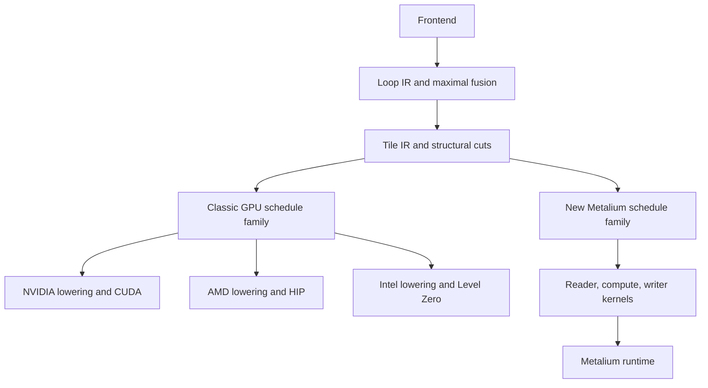

# Native Tenstorrent AMD and Intel backends

Status: proposed, 2026-10-12. The design has had an independent agent audit. Implementation and hardware
qualification are future work.

Keep Emmy's frontend, Loop IR, Tile IR, and schedule search shared. Add a Metalium schedule family for Tenstorrent.
Extend the classic GPU family for AMD Radeon AI PRO R9700 and Intel Arc Pro B70, with separate lowering and runtime
backends. Deliver native pointwise execution on one Tenstorrent chip first, then the same programs on AMD and Intel.

## Architecture

| Target | Schedule structure | Generated code and runtime | Later matrix acceleration |
| --- | --- | --- | --- |
| NVIDIA | Existing classic family | Existing CUDA path | Existing NVIDIA atoms |
| Radeon AI PRO R9700 | Classic family with AMD capabilities | HIP kernels and HIP runtime | RDNA WMMA |
| Intel Arc Pro B70 | Classic family with Intel capabilities | OpenCL C to SPIR-V or native modules; Level Zero | XMX |
| Tenstorrent | New Metalium family | Metalium data-movement and compute kernels | Tensix matrix operations |

The R9700 is RDNA 4, target `gfx1201`, and the B70 is Xe2. Instruction selection and fragment layouts must use those
architectures. An AMD deployment configuration alone does not provide compiler support. See the
[AMD specifications][amd-specs] and [Intel B70 datasheet][intel-specs].

### Shared compiler boundaries

Emmy's generic schedule interface already separates kernel, node, and edge decisions. Reuse its immutable contexts,
lazy extensions, accepted complete schedules, codecs, and materialization interface. Reuse the backend interface,
which already allows a backend to own the object returned by compilation.

1. **Target description.** Separate device capabilities, toolchain, and arithmetic policy from CUDA-specific
   properties. Backend selection and schedule-family selection are distinct. Keep SDK imports optional so inspecting
   the shared IR does not require every vendor runtime.
2. **Schedule completion.** Replace checks that identify completion with CUDA grid placement. A family must accept
   the complete schedule, and the selected backend must reject a terminal graph with unlowered computation.
3. **Lowering.** Keep Fold algebra, logical axes, indexing, dtypes, and graph identity shared. Let the target own
   coordinates, types, synchronization, memory transport, and instruction selection. Run only applicable lowering
   passes; adding a scalar renderer does not make NVIDIA-specific Kernel IR portable.
4. **Execution.** Share graph inputs, outputs, dependencies, and allocation lifetimes where their contracts match.
   Each backend owns its executable representation and launch details. A universal artifact format or a generalized
   Rust executor must not block the first Metalium result.

The existing one-thread-per-output classic pointwise lowering is the initial reusable subset. Cooperative reductions
contain NVIDIA shuffle, shared-memory, and coordinate assumptions. Matrix lowering also needs vendor-specific atoms
and fragment layouts. Port those deliberately in phase 2.

Loop fusion remains maximal. A slow or unschedulable fused region is a cut or lowering problem. Do not add a fusion
gate. Keep canonical normalization independent of target choices, and retain exact kernel identity plus context as
the evidence join. Computed facts stay out of knobs and golden fields.

## Metalium schedule family

The new family describes where tiles execute and how they move. Its decision structure fits the existing schedule
interface:

| Schedule level | Choices |
| --- | --- |
| Kernel | Core assignment, output-tile partition, traversal order |
| Node | Compute primitive, tile block, reduction strategy, permitted accumulator mode |
| Edge | Register retention or circular-buffer storage, buffering depth; later multicast |

Concrete core ranges, circular-buffer numbers, addresses, lifetimes, resource usage, and generated arguments are
derived materialization facts. They do not become stored decisions. Keep the existing structural node and operand
edge identities, including separate consumer edges that reach the same producer.

Schedule acceptance must check tile shapes, formats, physical layouts, usable L1 capacity, and destination-register
capacity. It must also check producer/consumer ordering and bounded-buffer progress. Equal produced and consumed tile
counts alone do not prove that waits and reservations cannot deadlock. Shared producers and repeated input reads
need explicit lifetimes; two consumers cannot independently pop the same destructive FIFO.

A scheduled Tile region lowers to one Metalium program:

1. Reader kernels move input tiles from DRAM into circular buffers in core-local L1.
2. Compute kernels evaluate the Tile expression tree using the chosen primitives.
3. Writer kernels move output tiles back to DRAM.

Generate arithmetic from the Tile expression tree so supported compositions fuse through the same lowering. Fused
intermediates stay in registers or L1. Explicit dtype conversions remain observable, even if the initial lowering
needs an L1 spill and reload to implement the required rounding.

The backend owns physical buffer layouts and the mapping from logical indices to tile addresses. Metalium's default
32 by 32 tile has an internal face ordering; a row-major reshape is insufficient. Start with interleaved DRAM buffers
at program boundaries. Add sharding and persistent L1 layouts only with explicit producer/consumer agreement. See the
[Metalium guide][metalium-guide] and [tensor layout description][metalium-layouts].

### Initial host integration

Use the TTNN package for allocation, conversion, and custom-kernel dispatch through `generic_op`. Emmy generates the
reader, compute, and writer sources and their program descriptors. Computation remains Emmy-generated; high-level
TTNN add or matmul operations are not the compiler implementation.

The inspected TT-Metal revision is `a11d86c19d3fa69b2995bb2a37f3f5acbfc66a3d`. Its descriptors accept generated source,
and `prepare_generic_op` can prepare a program without enqueueing it. Pin and qualify that revision or a released SDK
with the same verified interface. The preparation API is experimental. See the
[program descriptors][metalium-descriptors], [generic operation bindings][metalium-generic], and
[preparation tests][metalium-preparation].

This route avoids a new C++ or Rust Metalium binding before the first operation runs. Use the SDK's program cache
and argument-refresh mechanisms. Rebind input and output addresses for every invocation, and test cache hits with
different allocations. Start with one output, matching the initial integration contract.

## AMD and Intel lowering

For the R9700, reuse the classic pointwise structure and add HIP-specific source emission, compilation, allocation,
copies, and launches. Use native AMD code objects for `gfx1201`. Later add RDNA matrix atoms with their own fragment
layouts. [rocWMMA][rocwmma] supports the relevant architecture and is an initial implementation option; CDNA MFMA and
NVIDIA MMA mappings must not be reused as if they described RDNA.

For the B70, generate OpenCL C and compile through Intel's compiler tools to SPIR-V or a native module. Execute through
Level Zero. The [Level Zero programming guide][level-zero] documents the OpenCL C to SPIR-V to module-loading path.
This keeps the initial scalar path independent of SYCL host compilation. Later XMX support needs separately qualified
subgroup sizes, matrix types, and operand layouts; use the [Intel subgroup matrix extension][intel-matrix] as a source
for those contracts. Probe capabilities instead of carrying a universal 32-lane assumption.

Pin supported driver and compiler versions on each exact target. Matrix support in the architecture does not establish
support in an arbitrary installed toolchain. BF16 scalar storage and conversion may initially use generated bit
operations, with FP32 arithmetic, without depending on matrix extensions.

## Phase 1 Minimal native execution

Deliver three milestones. The first Tenstorrent result does not wait for AMD or Intel hardware.

| Milestone | Scope | Completion gate |
| --- | --- | --- |
| 1a Tenstorrent | One Wormhole chip, one Tensix core, static rank-2 BF16 tensors, dimensions divisible by 32, equal-shape inputs, one output | Generated Metalium kernels compile and execute through Emmy under the declared arithmetic contract |
| 1b R9700 | Same pointwise programs through classic scheduling and scalar HIP kernels; FP32 and BF16 | Compile and execute on an actual R9700 |
| 1c B70 | Same pointwise programs through classic scheduling and scalar Intel kernels; FP32 and BF16 | Compile and execute on an actual B70 |

Implement copy, add, multiply, ReLU, and fused compositions such as add followed by ReLU and two consecutive adds.
Use SFPU arithmetic for the initial Tenstorrent pointwise implementation. Qualify Wormhole first; Blackhole is a
separate target requiring its own checks.

Each supported case needs only one fixed legal schedule. It must still use complete schedule acceptance and codec
round trips, so phase 2 widens the catalog without replacing the scheduling interface. Do not invoke a prior trained
for an unsupported target or family to choose the initial schedule.

Implementation order:

1. Add explicit target dispatch and backend-specific terminal checks.
2. Add the Metalium schedule family and its initial singleton choices.
3. Lower supported Tile expressions into generated reader, compute, and writer kernels.
4. Connect allocation, compilation, argument binding, execution, and output retrieval through the SDK.
5. Expose backend selection through Emmy's existing compile and run workflow, with source inspection and CPU
   references that do not require CUDA. Treat the selection syntax as new implementation work.
6. Add AMD and Intel pointwise emission and execution using the same frontend programs.

Scope compilation sessions to a backend, target, toolchain, and arithmetic policy from the start. The current session
cache relies on its owner maintaining one compilation context. Preserve that ownership restriction explicitly or
reject incompatible reuse; do not assume the kernel identity alone isolates targets. Persistent artifact formats and
measurement integration can wait until phase 2.

Reject unsupported operations, layouts, shapes, or arithmetic modes with specific errors. Do not silently execute
unsupported computation on the host. Phase 1 excludes reductions, matmul, arbitrary strides, dynamic shapes,
autotuning, serving, and multi-device execution.

### Arithmetic contract

Wormhole arithmetic is not fully IEEE compliant. Its SFPU add and multiply flush denormal inputs and denormal or
negative-zero outputs. Disabling approximate math does not eliminate those differences. The matrix unit has additional
special-value behavior. See the [SFPMAD specification][wormhole-sfpmad] and
[floating-point representation specification][wormhole-floats].

Use Emmy's existing arithmetic-policy mechanism and document precisely which behavior each backend permits. Do not
assume CUDA's fast-math allowances automatically describe Tenstorrent. Reject strict arithmetic when the chosen
implementation cannot honor it. Special-value behavior must be checked against that declared policy, rather than
hidden behind a loose aggregate tolerance.

Retain explicit BF16 rounding boundaries in fused programs. Emmy's Loop runner treats narrow floating assignments as
float32 identities, so it cannot verify those boundaries. Use CPU PyTorch BF16 or an explicit per-operation BF16
reference for narrow-dtype correctness; use the Loop runner for appropriate structural and FP32 checks.

A required regression is `(a + b) + b` with `a = 1` and `b = 2^-8`. Rounding each addition to BF16 produces `1`.
Performing both additions in FP32 and rounding only the final result produces `1.0078125`. Add followed by ReLU alone
does not expose this error. The two-add case also checks repeated use of one input.

### Phase 1 verification

- Without hardware: schedule acceptance and codec round trips, generated source structure, target dispatch, resource
  refusal, and errors for unsupported computation. SDKs remain optional for shared IR tests.
- On each target: one tile, multiple tiles, repeated execution, and changed input and output allocations. Check
  returned shapes, dtypes, and values against the appropriate reference.
- Check fused compositions with no host transfer between their operations. Validate BF16 rounding and the declared
  treatment of NaNs, infinities, subnormals, signed zero, and rounding ties. Use exact checks where required and
  bounded numerical errors where the policy permits them; correlation alone is insufficient.
- Preserve the existing CUDA regression checks. Keep failures and timeouts observable through the execution path;
  a worker timeout is not a guarantee that a device reset is possible.

Phase 1 completes only after actual generated kernels run on all three new physical targets. Each milestone can land
independently. It establishes native pointwise execution and shared IR reuse, not performance or model support.

## Phase 2 Reductions matrices and measured schedules

Add reduction and matrix primitives, blocked traversal, and shape tails. For Metalium, add multiple cores and overlap
data movement with computation. For AMD and Intel, add cooperative reductions and vendor-specific matrix atoms.
Preserve explicit accumulator and conversion semantics when adding each implementation.

Widen the schedule catalogs and reuse Emmy's existing evidence store. Extend target, toolchain, and arithmetic
context where necessary. Evidence continues to join on exact kernel identity and compatible context. Do not apply
NVIDIA-trained priors to unsupported targets; use measured choices and deterministic defaults until suitable
training evidence exists.

Make golden, corpus, and artifact target descriptions represent each architecture directly, without fabricated CUDA
capabilities. Store input decisions and measurements, compute derived facts when read, and version caches when their
computations change. Use the existing run and benchmark workflow rather than adding benchmark scripts.

Benchmark one complete Metalium program per fused region. Reader, compute, and writer kernels overlap, so adding
their individual times does not price the region. Keep device execution and host conversion costs separately visible
when assessing the whole workload.

Gate this phase on correct reductions and matmuls on each target, reproducible schedule replay, compatible evidence
selection, and measurements from the exact installed hardware and software stack.

## Phase 3 Fused workloads and performance

Add norm, softmax, matmul epilogues, and attention components. Improve persistent device buffers, layouts across
kernel boundaries, sharding, multicast, and data reuse where measurements justify them. Compare complete workloads
against vendor implementations, including required layout conversions. Qualify a transformer block on each target.

## Phase 4 Model execution and serving

Add KV-cache handling, prefill and decode, framework memory and stream interoperability, deployment images, and
reproducible hardware qualification. Extend persistent runtime artifacts when their execution contract is known.
Multi-chip Tenstorrent execution follows reliable single-chip model execution.

## Independent audit

An independent agent reviewed the design against Emmy and upstream APIs. The accepted corrections are reflected in
the phase boundaries and gates:

- Keep phase 1 pointwise-only. Classic cooperative reductions require more than a scalar renderer.
- Define the Tenstorrent arithmetic contract before claiming correctness, and reject unsupported strict mode.
- Use explicit BF16 references and the two-add regression to check intermediate rounding.
- Require schedule acceptance and codec round trips even for singleton catalogs.
- Scope compilation caches to a target and arithmetic policy immediately.
- Reuse backend-owned compiled objects; do not make a universal runtime or artifact format a prerequisite.

The audit found no remaining architectural blocker for the revised phase 1, subject to actual device qualification.

[amd-specs]: https://rocm.docs.amd.com/en/latest/reference/gpu-specs.html
[intel-specs]: https://www.intel.com/content/dam/www/central-libraries/us/en/documents/2026-03/datasheet-b70-gpu.pdf
[metalium-guide]: https://github.com/tenstorrent/tt-metal/blob/a11d86c19d3fa69b2995bb2a37f3f5acbfc66a3d/METALIUM_GUIDE.md
[metalium-layouts]: https://github.com/tenstorrent/tt-metal/blob/a11d86c19d3fa69b2995bb2a37f3f5acbfc66a3d/tech_reports/tensor_layouts/tensor_layouts.md
[metalium-descriptors]: https://github.com/tenstorrent/tt-metal/blob/a11d86c19d3fa69b2995bb2a37f3f5acbfc66a3d/tt_metal/api/tt-metalium/program_descriptors.hpp
[metalium-generic]: https://github.com/tenstorrent/tt-metal/blob/a11d86c19d3fa69b2995bb2a37f3f5acbfc66a3d/ttnn/cpp/ttnn/operations/generic/generic_op_nanobind.cpp
[metalium-preparation]: https://github.com/tenstorrent/tt-metal/blob/a11d86c19d3fa69b2995bb2a37f3f5acbfc66a3d/tests/ttnn/unit_tests/operations/debug/test_generic_op_preparation.py
[rocwmma]: https://github.com/ROCm/rocWMMA
[level-zero]: https://oneapi-src.github.io/level-zero-spec/level-zero/latest/core/PROG.html
[intel-matrix]: https://registry.khronos.org/OpenCL/extensions/intel/cl_intel_subgroup_matrix_multiply_accumulate.html
[wormhole-sfpmad]: https://github.com/tenstorrent/tt-isa-documentation/blob/main/WormholeB0/TensixTile/TensixCoprocessor/SFPMAD.md
[wormhole-floats]: https://github.com/tenstorrent/tt-isa-documentation/blob/main/WormholeB0/TensixTile/TensixCoprocessor/FloatBitPatterns.md
